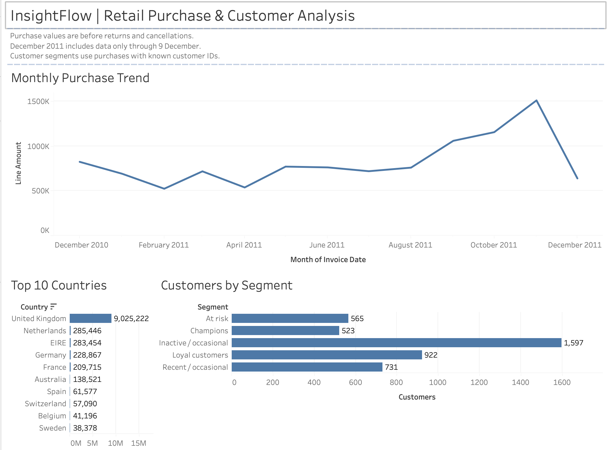

# InsightFlow: Retail Purchase and Customer Analysis

InsightFlow is a retail analytics project that uses Python, PostgreSQL,
and Tableau to explore historical transactions from the UCI Online
Retail dataset.

## Project objectives

- Examine data quality and prepare transaction data for analysis.
- Analyse monthly purchase trends, items, and countries.
- Calculate RFM measures and create customer segments.
- Reproduce selected analysis in PostgreSQL.
- Present findings in a Tableau dashboard.

## Tools used

- Python and Pandas — data preparation and analysis
- PostgreSQL and SQL — storing and querying purchase data
- Tableau Desktop — dashboard visualisation
- CSV — storing prepared data and analysis results

## Dataset

The UCI Online Retail dataset contains 541,909 transaction lines.
The records used here range from 1 December 2010 to 9 December 2011.

A transaction line is not necessarily a complete invoice: one invoice
can contain multiple lines.

## Key results

- 530,104 lines met the project's paid-purchase rules.
- The selected purchase total was 10,666,684.54.
- November 2011 had the highest monthly purchase total in the dataset:
  1,509,496.33.
- 4,338 identified customers were included in the RFM analysis.
- PostgreSQL row counts, invoice counts, and purchase totals were
  compared with the Python results.

## Data decisions and limitations

- Purchase totals are before returns and cancellations; they are not
  net revenue or profit.
- December 2011 is incomplete: the dataset ends on 9 December.
- Purchases without customer IDs are included in overall purchase
  analysis but excluded from customer segmentation.
- Exact duplicate rows were retained because they may represent
  legitimate repeated invoice lines. Their impact was measured.
- The RFM segments are based on a historical snapshot and documented
  scoring rules; they do not predict future customer behaviour.
- The item analysis initially excluded DOT, POST, and M as special
  codes. Other non-product entries may remain.

## Dashboard

The Tableau dashboard contains:

1. Monthly purchase trend
2. Top 10 countries by purchase value
3. Customers by RFM segment

The customer-segment chart uses a separate, pre-calculated summary
and is a fixed historical snapshot.

## Project status

The initial Python analysis, SQL analysis, and Tableau dashboard have
been completed. Further validation, portfolio documentation, and a
possible AI explanation feature are planned.

## Project files

- `notebooks/01_data_exploration.py` — loads, checks, and prepares the data.
- `notebooks/02_sales_analysis.py` — analyses monthly purchases, items, and countries.
- `notebooks/03_rfm_analysis.py` — calculates RFM scores and customer segments.
- `sql/01_purchase_analysis.sql` — contains the PostgreSQL analysis queries.
- `data/processed/` — contains the prepared purchase and customer data.
- `InsightFlow_Dashboard.twbx` — packaged Tableau dashboard.

## Running the Python analysis

From the InsightFlow project folder, activate the virtual environment:

```bash
source .venv/bin/activate
```

Then run the scripts in order:

```bash
python notebooks/01_data_exploration.py
python notebooks/02_sales_analysis.py
python notebooks/03_rfm_analysis.py
```

The first script retrieves the UCI dataset and saves the prepared CSV
files used by the later scripts. It needs the required Python packages
and access to the dataset.

## PostgreSQL setup and analysis

These steps assume PostgreSQL is installed, its server is running, and
you have a PostgreSQL user with permission to create a database.

First, run the Python data exploration script to generate:

`data/processed/retail_purchases.csv`

Connect to PostgreSQL from Terminal. Replace `YOUR_USER` with your
PostgreSQL username:

```bash
psql -U YOUR_USER -d postgres
```

Inside `psql`, create the database and connect to it:

```sql
CREATE DATABASE insightflow;
\c insightflow
```

From the `insightflow=#` prompt, create the table:

```sql
\i sql/00_create_table.sql
```

Import the prepared CSV:

```sql
\copy retail_purchases FROM 'data/processed/retail_purchases.csv' WITH (FORMAT csv, HEADER true)
```

Check the imported row count:

```sql
SELECT COUNT(*) FROM retail_purchases;
```

Finally, run the analysis queries:

```sql
\i sql/01_purchase_analysis.sql
```

Run these commands from the InsightFlow project directory so the relative
file paths can be found. Create the database and import the data only
once during the initial setup. Repeating the import would add duplicate
rows.

## Dashboard preview



## Python setup

From the InsightFlow project folder, create and activate a virtual
environment:

```bash
python3 -m venv .venv
source .venv/bin/activate
```

Install the recorded packages:

```bash
python -m pip install -r requirements.txt
```

Run the three Python scripts in order:

```bash
python notebooks/01_data_exploration.py
python notebooks/02_sales_analysis.py
python notebooks/03_rfm_analysis.py
```

The first script retrieves the UCI dataset and creates the prepared CSV
files used by the later scripts. It requires network access.